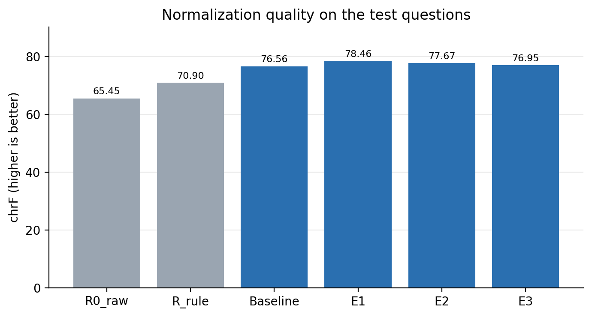
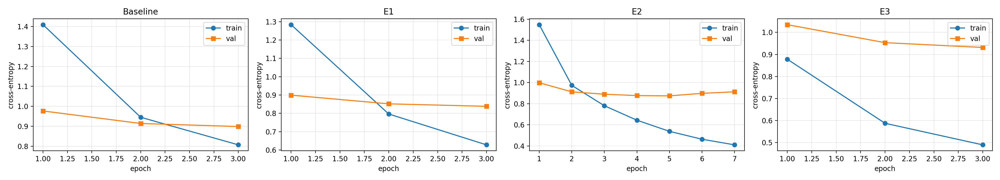

# Informal-to-Formal Query Normalization for a Lightweight Indonesian RAG Pipeline

Deep Learning course project

Team:

- Demetrius Howard Setiawan (2802424300)

- Haposan Emmanuel Tobias (2802417314)

- Jonathan Alston Jayapurnama (2802424156)

> Status: work in progress. Numbers below come from the current notebook run.

## What this project asks

Customers write to support teams in casual Indonesian ("gmn cara cek paket saya min?"), but FAQ documents are written in formal Indonesian. A search system can miss the right answer because of this gap.

We test one question: **does a small neural model that rewrites a casual question into a formal one improve a lightweight question-answering (RAG) system?**

## Pipeline

```
informal query
   -> IndoBART-v2 normalizer (fine-tuned)      -> formal query
   -> multilingual-e5-small retrieval (top-3)  -> FAQ passages
   -> Qwen2.5-1.5B-Instruct (grounded prompt)  -> answer, or "tidak tahu"
```

| Part | Model / setting |
|---|---|
| Normalizer | IndoBART-v2 (131.5M parameters), greedy decoding, max 64 tokens |
| Retrieval | multilingual-e5-small, `query:` / `passage:` prefixes, cosine similarity, top-3 |
| Generator | Qwen2.5-1.5B-Instruct, greedy, 96 new tokens, answers only from the retrieved FAQ |
| Training data | STIF-Indonesia (2,499 informal/formal sentence pairs from customer-service chats), loaded from Hugging Face inside the notebook |

## Experiments

| ID | Description |
|---|---|
| Baseline | Fine-tune IndoBART-v2 with the encoder frozen |
| E1 | Encoder unfrozen |
| E2 | Encoder unfrozen, up to 10 epochs |
| E3 | E1 plus 1,701 synthetic slang pairs |
| `R0_raw` | Reference: use the raw informal query (no normalization) |
| `R_rule` | Reference: simple word-list replacement |
| `Oracle_formal` | Reference: the human-written formal query |

## Results (current run)

**Normalization quality** (chrF, 150 test questions):

| R0_raw | R_rule | Baseline | E1 | E2 | E3 |
|---|---|---|---|---|---|
| 65.45 | 70.90 | 76.56 | **78.46** | 77.67 | 76.95 |



**FAQ retrieval** (30 FAQ documents, 126 labeled queries):

| Condition | Recall@1 | Recall@3 |
|---|---|---|
| R0_raw | 52.4 | 69.8 |
| R_rule | 50.8 | 69.8 |
| Baseline | 54.0 | 67.5 |
| E1 | 53.2 | 70.6 |
| E2 | 54.0 | 68.3 |
| E3 | 53.2 | 65.1 |
| Oracle_formal | 52.4 | 69.8 |


**Training curves:**



**Generated answers** (30 questions, graded by hand as 0/1):

| Condition | Correct | Faithful to FAQ |
|---|---|---|
| R0_raw | 10 | 27 |
| E1 | 11 | 25 |
| Oracle_formal | 12 | 28 |

**Main finding.** The normalizer clearly makes informal text look more like formal text (chrF 65.45 to 78.46). But we found **no reliable gain** in retrieval or in answer quality. Exact McNemar tests on answer correctness give p = 1.0 (E1 vs. raw) and p = 0.73 (Oracle vs. raw). With only 30 FAQ documents and 30 graded answers, small differences cannot be told apart from noise. Even the Oracle (perfect formal query) did not clearly help, which points at retrieval and generation limits rather than at the query wording alone.

## Repository contents

| File | Purpose |
|---|---|
| `AOL_DeepLearning.ipynb` | Full experiment notebook (data, training, retrieval, generation, tests) |
| `faq.csv` | 30 FAQ documents (`faq_id`, `question`, `answer`). **Required** for the retrieval and generation sections |
| `gold.csv` | 126 test queries mapped to the correct FAQ (`test_id`, `faq_id`). **Required** with `faq.csv` |
| `test_queries_for_labeling.csv` | The 150 test queries (`test_id`, `informal`, `formal`) used for labeling `gold.csv` |
| `gen_outputs.csv` | Generated answers before grading (`correct` and `faithful` still empty) |
| `gen_outputs_graded.csv` | Same file after hand grading (`correct`, `faithful`, 0/1). Input for the McNemar cell |
| `results_table.csv` | Result table: chrF, BLEU, exact match, Recall@1/3, MRR, training details, latency |
| `loss_curves.png` | Training and validation loss curves |
| `fig_chrf.png`, `fig_retrieval.png` | Result figures produced by the notebook |

## How to run the notebook

1. Open `AOL_DeepLearning.ipynb` in Google Colab and choose a **GPU runtime** (we used a Tesla T4). The first cell installs the needed packages.
2. Upload `faq.csv` and `gold.csv` to the Colab working folder **before** running the retrieval section. Without them the notebook switches to a proxy mode whose numbers are not valid and must not be reported. The notebook prints `MODE: FAQ NYATA` when the real files are found.
3. Run all cells from top to bottom. Generation (Qwen) needs the GPU and writes `gen_outputs.csv`.
4. For the answer-quality test, grade the `correct` and `faithful` columns of `gen_outputs.csv` by hand (0/1), save the result as `gen_outputs_graded.csv`, upload it, and run the McNemar cell.

## Limitations

- The FAQ is small (30 documents) and the labeled set has 126 queries, so retrieval differences of one or two questions are within noise.
- Answer quality was graded by hand by the team, not blind to the condition, and by a single grader.
- Only the word-list baseline was tested as an alternative to IndoBART-v2. Other normalizers (for example IndoBERT-based or mT5) were not trained.

## References

Main sources: STIF-Indonesia (Wibowo et al., 2020), IndoBART / IndoNLG (Cahyawijaya et al., 2021), BART (Lewis et al., 2020), RAG (Lewis et al., 2020), multilingual E5 (Wang et al., 2024), Qwen2.5 (Qwen Team, 2024). The full APA reference list is in the project report.
